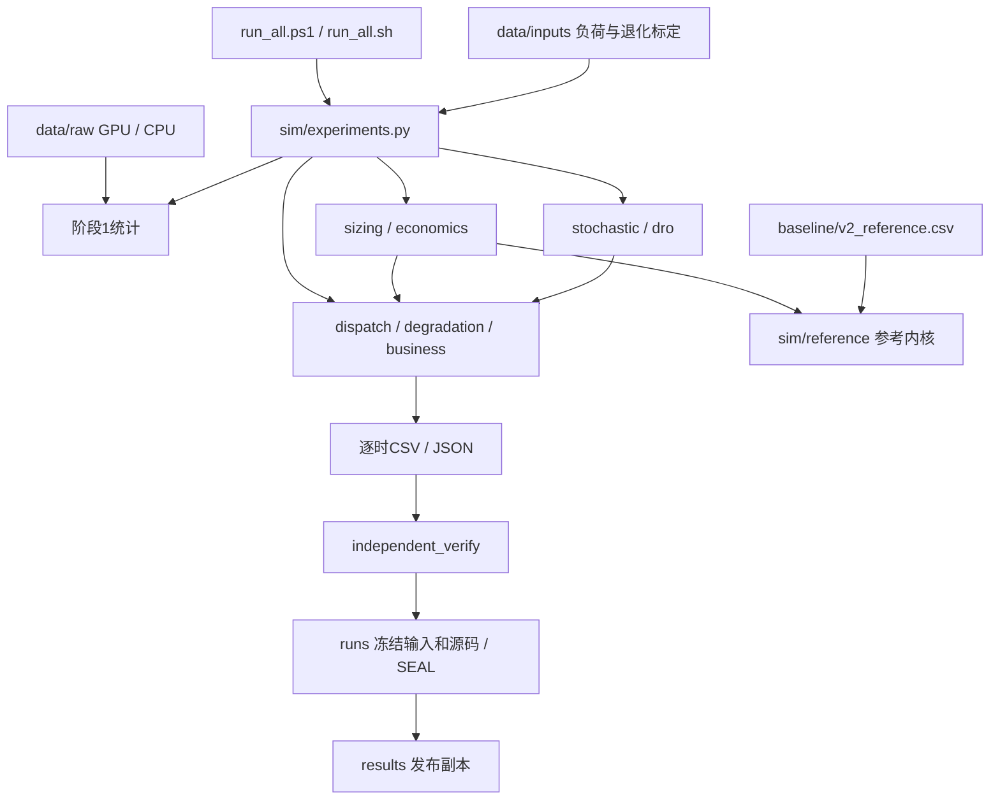

# V3架构与保留边界

目录重构只调整文件职责、导入和路径，不改变物理模型、市场参数或求解目标。旧封存runs/的内容保持不变；迁移记录保存原始文件哈希。

## 运行依赖

MPC、迁移和作业群分解使用同一当前V3参数/约束体系。sim/reference/保留V2口径是为了验收锚点，与archive/里的过时执行脚本有明确区别。

## 三种保留口径

| 目的 | 保留内容 | 可以舍弃的内容及影响 |
|---|---|---|
| 保证今后完整重跑V3 | sim/含reference、data/inputs、两份openb原始数据、baseline、溯源表、入口/依赖/测试、已安装环境 | archive、replay和旧生成结果不作为输入 |
| 继续开发与研究 | 上述内容加tools、当前docs、研究/规划资料、evidence、Git历史 | 旧控制台日志一般可归档后检查清理 |
| 复核已完成的原V3验收 | 上述内容加run_review.csv标记的被引用runs原件与相应results副本 | 删除这些原件后不能再核验那一次哈希，但仍能做新计算 |

完整的Git工作树约定保留当前源码、全部输入/基线、维护工具和当前文档。生成结果不提交；新运行会自动创建results/和runs/。原始数据和标定文件始终受Git管理，不再藏在可清理输出目录。

## 分类与清理规则

- “必须保留”：删掉会破坏代码、输入、完整验收或版本管理。
- “建议保留证据”：不影响新求解，但删除会损失对应历史复核能力。
- “检查后可手动删除”：明确列出删除影响，由用户决定。
- “重建后可手动删除”：主要是.venv；删除后须先重建依赖环境。
- “按研究需要保留”：文献、原始路线图及Azure历史轨迹，不能因不参与数值计算就误判为无价值数据。

本次没有执行删除，也不提供批量删除脚本。目录迁移采用逐文件明确路径，并逐个比较迁移前后SHA-256。Git标签v3-before-layout保留整理前代码；本次提交记录整理后的规范结构。

## 证据位置

- reorganization_moves.csv：91个初始文件迁移的原路径、新路径、分类及哈希。
- file_inventory.csv：逐文件/环境/缓存分类快照；维护工具可重新生成。
- run_review.csv：逐运行区分被引用原件、未引用历史和未封存失败运行。
- ../../evidence/layout_validation.json：重构后的测试、同哈希回归与无旧产物环境运行结果。
- ../../evidence/v3_delivery.json：原V3科学验收摘要；其结论及已声明的科研边界未因整理而改变。
